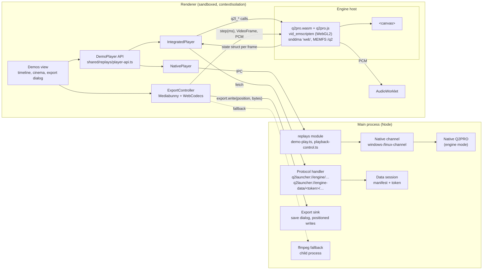
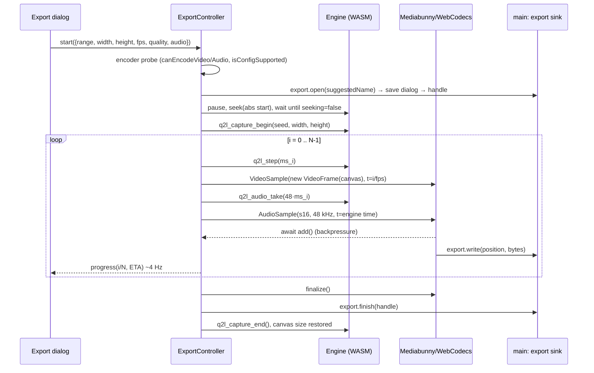

# Integrated Demo Player and MP4 Export — Concept

Status: **Draft** (vision, decisions and story drafts 281–319; not scheduled). This document fixes
how the demo browser (`replays` module) gets a second way to play a demo. **Integrated mode**
runs Q2PRO compiled to WebAssembly inside the launcher window. A JS API controls it in place of
cfg polling, and it can export a demo deterministically to MP4. Today's playback in a native Q2PRO
window stays as **engine mode**, and the user switches between the two.

This document follows the architecture rules in [CLAUDE.md](../../CLAUDE.md):

- The feature lives in the existing `replays` module.
- The IPC contract is written first, and every renderer-supplied payload carries a zod schema.
- The renderer never receives a path; it gets a token or a handle.
- Main sends i18n keys, never prose.
- A control that cannot work in a mode or on a platform stays visible, disabled, with its reason
  as text.

It builds on the demo browser ([demo-browser.md](demo-browser.md), whose §9.2 researched this
option and deferred it) and on the replays system doc
([replays-module.md](../systems/replays-module.md)).

**Markers.** Every technical statement carries one:

- **[V: file/function]**: verified in source.
  - Paths without a prefix are this repo.
  - `q2pro:` is the upstream mirror [github.com/q2pro/q2pro](https://github.com/q2pro/q2pro) @
    `601a8df` (2025-12-11).
  - `mashed:` is the fork [github.com/MashedD/q2pro](https://github.com/MashedD/q2pro) @ `3139866`
    (2026-10-03).
- **[V: source]**: an external fact, linked.
- **[A]**: an assumption. A spike or story checks it. Open decisions are in §17.

---

## TL;DR

- **Vision:** a demo plays inside the launcher like a video and can be exported as one. Today's
  setup has no second game window to place, no console spam, no polling lag and no PAUSED
  overlay.
- **Two modes, switchable** (user decision). **Engine** is today's native Q2PRO window with the
  cfg/stdin channel. **Integrated** is Q2PRO as WebAssembly in a `<canvas>` (WebGL2). Both sit
  behind one transport-independent `DemoPlayer` API. The cfg/exec hack disappears from
  integrated mode and stays encapsulated in engine mode.
- **Engine source:** Q2PRO, not Qwasm2/Yamagi, because Q2PRO can seek with snapshots and plays
  Q2PRO demos fully.
  - Upstream `skullernet/q2pro` is gone (404).
  - The active fork MashedD/q2pro already has an Emscripten target.
  - The working assumption is that fork at a pinned commit plus our own patch series.
- **Control:** direct calls (`q2l_*` exports) send commands in. A per-frame state struct carries
  state out. There are no callbacks in the frame path.
- **Export:** a deterministic `step(ms)` mode feeds the canvas to WebCodecs H.264 and the engine's
  own mixer to AAC. Mediabunny builds the MP4 and streams it to disk through main.
  - Fallbacks: the `@mediabunny/aac-encoder` polyfill (Linux has no WebCodecs AAC), then ffmpeg
    over Node.
  - An optional live clip uses MediaRecorder.
- **Not shipped:** game data, which comes from the user's installation. Networking and multiplayer
  are out of scope for the WebAssembly build.
- **Biggest open points:** the engine base and where its patches live, the default mode, the
  legal clarification (GPL engine in the launcher process, FFmpeg parts, codec patents), and
  whether MVD2 is needed in integrated mode.

---

## 1. Vision

Watching a demo should feel like watching a video. Press play, scrub, pause, step frame by frame,
and the picture reacts at once, inside the launcher where the list, the comments and the
timeline already are. A great frag should be one click away from an MP4 that can be shared,
with sound that matches the picture exactly.

The native engine window has served the demo browser well. It pays for that with a second window
that has to be placed over the launcher, a control loop that writes plumbing into the game
console, a quarter-second lag on every command, and an engine-drawn PAUSED picture. Integrated
mode removes all of that by running the same engine inside the launcher. Engine mode stays for
whoever prefers it and for whatever integrated mode cannot do yet.

## 2. Scope

### In scope (v1)

- Integrated playback of `.dm2` and `.dm2.gz` (loose, in another installation, in an extra folder,
  or as a zip entry) with sound, on Windows and Linux.
- A playback-mode switch (engine / integrated) in Settings and in the Demos view.
- One `DemoPlayer` API used by the whole demo UI:
  - play/pause, seek (relative, absolute, percent), speed, volume, console line;
  - frame step and HUD options;
  - events for position, pause, seeking, map, POV, HUD values, finished, errors.
- Integrated fullscreen and cinema mode.
- MP4 export of a demo or a range, with these options:
  - resolution independent of the visible canvas;
  - fps;
  - quality;
  - HUD on or off;
  - sound on or off.

  The export shows progress and can be cancelled, leaving no partial file.

- The encoder chain: WebCodecs H.264/AAC, then the AAC polyfill, then ffmpeg. An optional live
  clip via MediaRecorder.

### Deliberately not in v1

- **MVD2 in integrated mode.**
  > Rationale: Q2PRO plays MVD2 through a local MVD server that opens UDP sockets (§8.7). A spike
  > decides whether it is worth it. Until then MVD2 plays in engine mode, with a visible hint.
- **Engine in a Worker with OffscreenCanvas.**
  > Rationale: it would allow lazy file access and keep level loads off the UI thread. It is the
  > fallback if memory or load time demand it (§11 R2/R8), not the starting point.
- **Integrated mode as the default.**
  > Rationale: engine mode stays the default until the hardening increment is done (§17).

### Non-goals (permanent)

- Networking or multiplayer in the WebAssembly build. Live servers stay in the server browser.
- Shipping game data. Paks and maps always come from the user's installation.
- Removing engine mode.
- Video editing (cuts, titles, transitions). Range export is all there is.
- Re-release (MD5) models in integrated mode. Q2PRO needs texture buffers and SSBOs for them,
  which WebGL2 does not have [V: q2pro:src/refresh/models.c, around l.1710].
- macOS. `electron-builder.yml` has a `mac:` block, but CLAUDE.md supports Windows and Linux.

## 3. Design decisions taken (from the requirements interview)

| Topic       | Decision                                                                                                                                                                                                                             | Rationale                                                                             |
| ----------- | ------------------------------------------------------------------------------------------------------------------------------------------------------------------------------------------------------------------------------------ | ------------------------------------------------------------------------------------- |
| Engine      | Port Q2PRO (GPLv2) to WebAssembly with Emscripten; it runs in the Electron renderer as a `<canvas>` with WebGL2                                                                                                                      | One engine for both modes, the real renderer                                          |
| Engine base | Q2PRO, not Qwasm2/Yamagi; Qwasm2 only as an Emscripten reference                                                                                                                                                                     | Q2PRO seeks forward and backward (snapshots) and is fully compatible with Q2PRO demos |
| Control     | A JS API with direct calls: commands in, state events out; the cfg/exec hack goes; commands and events are defined independent of the transport                                                                                      | No console spam, no polling latency                                                   |
| Export      | Deterministic rendering with a fixed step (e.g. 1/60 s); canvas → WebCodecs `VideoEncoder` (H.264) → Mediabunny MP4; per-frame audio from the engine mixer → AAC; ffmpeg over Node as fallback; optional live clip via MediaRecorder | Frame-exact, reproducible, A/V-synchronous exports                                    |
| Game data   | Not shipped; loaded from the user's Q2 installation                                                                                                                                                                                  | Licence                                                                               |
| Network     | Networking and multiplayer in the WebAssembly build are out of scope for now                                                                                                                                                         | Demos are local files                                                                 |
| Modes       | Demo playback is switchable between engine mode and integrated mode                                                                                                                                                                  | User request: keep the native window as an option                                     |

## 4. Tech decisions

| Area           | Choice                                                                                                                                                       | Rationale                                                                                        |
| -------------- | ------------------------------------------------------------------------------------------------------------------------------------------------------------ | ------------------------------------------------------------------------------------------------ |
| Engine build   | Emscripten in a pinned `emscripten/emsdk` Docker image, Meson cross file, `npm run engine:build`                                                             | Reproducible; Docker is already required for act and `verify:release` [V: `.claude/ai-scrum.md`] |
| Engine source  | Pinned upstream commit + patch series under `engine/` in this repo [A, §17 Q3]                                                                               | No vendored engine tree; GPL source offer is the commit plus patches                             |
| Muxing         | Mediabunny (MPL-2.0) [V: [GitHub](https://github.com/Vanilagy/mediabunny)]                                                                                   | Pure TS, WebCodecs-based, streams to a custom target                                             |
| AAC fallback   | `@mediabunny/aac-encoder` (FFmpeg AAC as WASM, `registerAacEncoder()`) [V: [package](https://github.com/Vanilagy/mediabunny/tree/main/packages/aac-encoder)] | Linux and Windows N have no WebCodecs AAC                                                        |
| Video fallback | ffmpeg as a child process of main, fetched like `7za` [V: `scripts/fetch-7za.mjs`]                                                                           | Decision "ffmpeg fallback"; scope set by spike 282                                               |

## 5. Core terms & model

- **Engine mode:** the native Q2PRO (or R1Q2) process, steered over the cfg/exec channel (Windows)
  or stdin (Linux). This is today's behaviour.
- **Integrated mode:** the WebAssembly engine in the launcher window.
- **`DemoPlayer`:** the one interface the UI talks to. `NativePlayer` and `IntegratedPlayer`
  implement it.
- **Step mode:** the engine advances by an exact number of milliseconds per call, independent of
  real time. The export uses it.
- **Data session:** main's per-playback allowlist of the game files the engine may load, behind a
  random token.
- **Export sink:** main's file writer for one export, addressed by a handle.

```
UI ──► DemoPlayer ──┬─► NativePlayer ──IPC──► main replays ──► cfg/stdin channel ──► Q2PRO process
                    └─► IntegratedPlayer ──q2l_* calls──► q2pro.wasm ──► <canvas> / AudioWorklet
                                 ▲                         │ state struct per frame
                                 └─────────────────────────┘
Export dialog ──► ExportController ──step(ms), VideoFrame, PCM──► Mediabunny/WebCodecs
                                                     └──IPC export.write──► main export sink ──► file
```

## 6. Today's playback and its problems

- **Launch.** `demoPlay` resolves the demo id in main, re-checks eligibility and containment, and
  starts Q2PRO with `+demo` [V: `src/main/modules/replays/demo-play.ts`].
  - A demo outside the installation's `demos` folder is played from a temporary copy in
    `<gamedir>/demos/_launcher/` [V: `demo-staging.ts`].
  - R1Q2 plays via `+demomap`, Stop only [V: `playback-channel/engine-less-channel.ts`].
- **Windows channel** [V: `playback-channel/windows-channel.ts`, `protocol.ts`]:
  - The launch args set `logfile 2`, `logfile_flush 3` and `logfile_name q2l_demo.log`, then
    `+exec q2l_loop.cfg`.
  - The loop is `alias q2l_loop "exec q2l_ctl.cfg; wait 13; q2l_loop"`.
  - The control file polls `echo POS $cl_demopos FS $vid_fullscreen P $cl_paused` and runs one
    guarded line per pending command: `if $q2l_seq < N then "exec q2l_cmd_N.cfg; set q2l_seq N;
echo ACK N"`.
  - Answers are read by tailing the logfile every 50 ms.
- **Linux channel:** the console over stdin/stdout with `sys_console 1`, polled every 100 ms
  [V: `protocol.ts` `linuxLaunchArgs`, `LINUX_POLL_MS`].
- **Commands:** `pause`, `seek ±N`/`seek N`, `timescale X`, `s_volume`, plus a checked free console
  line [V: `src/shared/replays/timeline.ts` `buildTimelineCommand`, `demo-control.ts`].
- **Position:**
  - `$cl_demopos` prints `m:ss.f`, computed as `frames_read / 10`, so it moves in 100 ms steps
    [V: q2pro:src/client/main.c `CL_DemoPos_m`].
  - Main pushes it every 250 ms [V: `POSITION_PUSH_MS`].
  - A pause is read from `cl_paused`. Without that value, a position that stays the same is taken
    as a pause [V: `reducePlaybackView`].
- **Display:**
  - **Stage:** a borderless Q2PRO window placed over a 4:3 area of the Demos view (Windows window
    placement; X11 via the X-Resource PID) [V: `stage.ts`, `x11/stage-window.ts`,
    `components/DemoStage.tsx`].
  - **Cinema:** an always-on-top overlay `BrowserWindow` [V: `src/main/cinema-window.ts`].
  - **Fullscreen:** through in-game binds.
- **Formats:** `.dm2`, `.mvd2`, `.dm2.gz`, `.mvd2.gz` and zip entries [V: `discovery.ts` l.69–77].
  The duration comes from the launcher's own frame-count pass (`knownDurationMs`).
- **Electron:**
  - Version 43.8.4 [V: `node_modules/electron/package.json`].
  - Every window uses `contextIsolation: true`, `sandbox: true`, `nodeIntegration: false`,
    `webSecurity: true` and one preload [V: `src/main/window-shared.ts` `rendererWebPreferences`].
  - The production CSP has `script-src 'self'` **without** `'wasm-unsafe-eval'`
    [V: `src/main/lib/renderer-source.ts` `PRODUCTION_CSP`].
  - The privileged scheme already serves feed images [V: `src/main/index.ts`].
- **Build targets:** Windows `nsis` + `zip` (x64) and Linux `AppImage`
  [V: `electron-builder.yml`].

| Problem         | Cause                                                                                                                                                                                |
| --------------- | ------------------------------------------------------------------------------------------------------------------------------------------------------------------------------------ |
| Console spam    | Every ~200 ms loop tick prints `Execing q2l_ctl.cfg` + `POS …`. Story 174 only throttled it to ≈10 lines/s and hid it with `con_notifylines 0` [V: `docs/requirements/done/174-…md`] |
| Polling latency | Wait loop + logfile tail + 250 ms push; control→ACK p95 ≈ 254–291 ms [V: `protocol.ts` comment, `spikes/185-control-latency/RESULT.md`]                                              |
| Separate window | Placement per window system, no Wayland answer, focus and always-on-top issues (`stageNotice`)                                                                                       |
| PAUSED overlay  | `scr_showpause 1` draws the pause picture [V: q2pro:src/client/screen.c `SCR_DrawPause`]                                                                                             |
| Coarse position | `$cl_demopos` moves in 100 ms steps; pause is partly inferred                                                                                                                        |
| No video export | Q2PRO has no video recording [V: grep q2pro; demo-browser.md §9.4]                                                                                                                   |

**Research findings that shape the plan.**

1. `github.com/skullernet/q2pro` no longer exists. The MashedD README says "As Skuller's repo was
   removed …". `q2pro/q2pro` is a mirror at 2025-12-11.
2. MashedD/q2pro already has a working Emscripten target (merged 2026-10-02)
   [V: mashed:`build-web.sh`, `cross-web.txt`, `meson.build` `web` branch;
   `src/unix/video/emscripten.c`; `src/unix/system.c` `emscripten_set_main_loop`; `src/unix/hunk.c`].
   Limits of that target:
   - It builds with `-O0` and `ASSERTIONS=2` ("Avoid optimizer/wasm validation issues").
   - Sound goes through OpenAL.
   - The game library is a `SIDE_MODULE`, and `baseq2` is preloaded at build time.

   The upstream mirror has no `__EMSCRIPTEN__` at all, but already detects WebGL in its GL loader
   [V: q2pro:src/refresh/qgl.c `parse_gl_version`].

**Checking the decisions against the code.** No hard counter-argument was found. These points
refine them:

- **Q2PRO, not Qwasm2.** Confirmed: seek with snapshots, `.dm2.gz` and MVD are Q2PRO client code
  [V: q2pro:src/client/demo.c `CL_Seek_f`, `CL_EmitDemoSnapshot`, `read_first_message`].
  - Caveat: MVD2 is not played by the client but by a local MVD server that calls
    `NET_Config(NET_SERVER)` [V: q2pro:src/server/mvd/client.c, src/server/init.c, around l.438].
- **"SDL2 drivers for video and sound."** That is the native build. For Emscripten the existing
  path is a dedicated video driver without SDL (`vid_emscripten`). The export also needs **its
  own DMA sound driver**, because neither SDL audio (callback-driven) nor OpenAL (mixed in the
  browser) hands samples back per frame [V: q2pro:src/client/sound/dma.c `s_drivers[]`,
  `DMA_Update`].
- **"The cfg/exec hack goes."** This holds for integrated mode. Engine mode keeps its channel
  because of the mode switch, but behind the same API (§9.4).
- **Export.** WebCodecs AAC encoding exists in Chromium only on Windows (Media Foundation) and
  macOS. It is missing on desktop Linux and on Windows N
  [V: [MDN Codec selection](https://developer.mozilla.org/en-US/docs/Web/API/WebCodecs_API/Codec_selection),
  [Chromium "Add MF AAC Encoder"](https://groups.google.com/a/chromium.org/g/feature-media-reviews/c/vilCOgU5Hl4)].
  So Linux always needs a fallback, and the AAC polyfill is lighter than ffmpeg.
- **CSP.** WebAssembly compilation needs `'wasm-unsafe-eval'` in `script-src`
  [V: [MDN script-src](https://developer.mozilla.org/en-US/docs/Web/HTTP/Headers/Content-Security-Policy/script-src)].
  This is a security-relevant change (§8.6).

## 7. Architecture



- **Main** trusts no renderer path.
  - The data session resolves the demo id and installation id itself (as `demo-play.ts` does)
    and builds an allowlist of files behind a random token.
  - The protocol handler serves only allowlisted entries.
  - The export sink writes only to the file chosen in the save dialog, addressed by a handle.
  - All new channels are contract-first in `src/shared/modules/replays.ts`.
- **Renderer.**
  - The UI knows only `DemoPlayer`.
  - `IntegratedPlayer` owns the engine and the canvas; `ExportController` owns the encoding
    pipeline.
  - Everything stays in the `replays` module; the shell is not touched.
- **Engine host.** It runs on the renderer's main thread, in the same document as the UI:
  - direct calls;
  - `VideoFrame(canvas)` without a detour;
  - Emscripten's html5 API expects it [V: mashed:emscripten.c].

## 8. Engine port

### 8.1 Source base and build

- **Base [A, §17 Q2]:** MashedD/q2pro at a pinned commit (`3139866`) plus our patch series. It is
  Q2PRO and actively maintained, and it has the Emscripten target. The upstream mirror stays the
  reference for upstream behaviour.
- **Layout [A, §17 Q3]:**
  - `engine/UPSTREAM` (repo URL + commit)
  - `engine/patches/NNNN-*.patch`
  - `engine/cross/emscripten.ini`
  - `engine/docker/Dockerfile` (pinned `emscripten/emsdk`)
  - `scripts/engine/build.mjs`
- **Build output.** `npm run engine:build` fetches the commit into `.engine-build/` (gitignored),
  applies the patches, builds in the container and writes `q2pro.js` + `q2pro.wasm` to
  `resources/engine/` (gitignored).
- **Meson options** [V: q2pro and mashed `meson_options.txt`]:
  - Disabled: `-Dlibcurl=disabled -Dopenal=disabled -Dsdl2=disabled -Dx11=disabled
-Dwayland=disabled -Davcodec=disabled -Dlibjpeg=disabled`.
  - Off: `-Dsystem-console=false -Dclient-gtv=false -Dclient-ui=false -Dmvd-server=false
-Dsave-games=false -Dtests=false`.
  - On: `-Dzlib=enabled -Dlibpng=enabled -Dsoftware-sound=enabled`.
  - `mvd-client` stays on for the MVD2 spike.
  - `software-sound` currently requires `win32 or sdl2.found()` [V: mashed:meson.build, around
    l.608], so a patch allows it for `web` with our own driver.
- **Build-system patches:**
  - Meson always builds `q2proded` and the game library, and `src/unix/meson.build` always adds
    `dependency('threads')` [V: q2pro:meson.build l.425–455, src/unix/meson.build l.20]. The web
    branch builds neither, and no threads.
  - **No game library is needed for demos.** `SV_InitGameProgs` only runs when a local map
    server spawns, and MVD uses the built-in `mvd_ge` [V: q2pro:src/server/game.c,
    src/server/init.c, around l.469]. That drops `MAIN_MODULE`/`SIDE_MODULE` and mashed's long
    export list.
- **Link flags (target):**
  - `-O2 -sMIN_WEBGL_VERSION=2 -sMAX_WEBGL_VERSION=2 -sALLOW_MEMORY_GROWTH=1
-sMAXIMUM_MEMORY=2GB -sMODULARIZE=1 -sEXPORT_ES6=1 -sENVIRONMENT=web -sFORCE_FILESYSTEM=1`.
  - Exported functions `_main,_q2l_…`; runtime methods `FS,cwrap,HEAPU8,HEAP16`.
  - No `ASSERTIONS` in release builds.
  - Whether `-O2` hits the validation errors mashed saw is risk R1.

### 8.2 Main loop and time

- **Today.** `Qcommon_Frame` [V: q2pro:src/common/common.c] runs these steps:
  1. `NET_Sleep` (`Sys_Sleep`/`poll`).
  2. Reads `Sys_Milliseconds` (CLOCK_MONOTONIC).
  3. Busy-waits until msec ≥ 1.
  4. Clamps msec > 250 to 100.
  5. Applies `fixedtime` (cheat cvar, fixes msec) or `timescale`.
  6. Runs `SV_Frame` and `CL_Frame`.

  mashed replaces the loop with `emscripten_set_main_loop(Qcommon_Frame, 0, true)`
  (requestAnimationFrame) [V: mashed:src/unix/system.c `main`].

- **Target: two entry points and no Emscripten-owned loop.**
  - `q2l_frame(realMs)` is the real-time tick, called from `requestAnimationFrame`.
    `Qcommon_Frame` runs without `NET_Sleep` and without the busy-wait.
  - `q2l_step(ms)` is the deterministic step: `setjmp(com_abortframe)`; `com_localTime += ms`;
    `SV_Frame(ms)`; `CL_Frame(ms)`. It never calls `Sys_Milliseconds`, and it forces one refresh
    per step.
  - Capture forces `cls.active = ACT_ACTIVATED`, `cl_async 1` and `r_maxfps 0`. Otherwise
    `CL_Frame` skips the refresh (`SYNC_SLEEP_60` without focus, `SYNC_MAXFPS`)
    [V: q2pro:src/client/main.c `CL_UpdateFrameTimes`, `CL_Frame`].
- **Integer milliseconds.**
  - The step for frame i is `ms_i = round((i+1)·1000/fps) − round(i·1000/fps)`. At 60 fps that
    gives 17/17/16, and at 30 fps 33/33/34.
  - 25 fps and 50 fps are exact.
  - Video timestamps and engine time stay less than 1 ms apart.
- **Randomness.** `Q_srand(time(NULL))` runs in `Qcommon_Init` [V: q2pro:common.c l.884].
  `q2l_capture_begin(seed)` reseeds, so particles and effects reproduce.
- **Errors.** `Com_Error` longjmps to `com_abortframe`. Emscripten supports `setjmp`/`longjmp`
  [A: the cost is measured in a spike].
- **Demo end.** `cl_demowait 1` holds the last frame instead of disconnecting with "Demo finished"
  [V: q2pro:demo.c `finish_demo`].
- **Background.** A hidden window throttles requestAnimationFrame and timers, which pauses
  real-time playback (intended). The export runs as an `await` loop instead, and main sets
  `webContents.setBackgroundThrottling(false)` for its duration [A].

### 8.3 Renderer: GLES3 to WebGL2

- **Detection.** "WebGL" in `GL_VERSION`, or `GL_ANGLE_webgl_compatibility`, sets
  `gl_config.webgl` and clears `QGL_CAP_CLIENT_VA`, so the engine uses the VBO/GPU-lerp path
  [V: q2pro:src/refresh/qgl.c, around l.516/770–774].
- **Shader backend.** It needs ES 3.0 + UBO, emits `#version 300 es`, and is the default
  [V: q2pro:src/refresh/shader.c l.56–68]. The legacy backend is excluded on ES ≥ 2.
- **What WebGL2 lacks is already guarded:**
  - `glPolygonMode`, `glClearDepth` and `glDepthRange` are not loaded on ES.
  - The renderer uses no `glMapBuffer`, `GL_QUADS` or `GL_BGRA`.
  - The only loss is MD5 models.
- **Context.** `vid_emscripten` sets `alpha=false`, `stencil=true`, `antialias=false`,
  `majorVersion=2` [V: mashed:emscripten.c `init`].
  - `preserveDrawingBuffer` stays `false`; the export reads the canvas in the same task, right
    after `q2l_step` [A].
  - Fallback: `preserveDrawingBuffer=true` only while capturing.
- **Occlusion queries (flares).** They poll `GL_QUERY_RESULT_AVAILABLE` [V: q2pro:tess.c l.393].
  WebGL2 delivers results only after the event loop runs [A], so flares are off while capturing.
- **Overlays off in integrated mode.** These are session cvars with no restore needed, because the
  WebAssembly engine writes no installation config:
  - `scr_showpause 0`;
  - `cl_autopause 0`, because the engine otherwise pauses while the console or menu is open
    [V: q2pro:main.c `CL_CheckForPause`];
  - `con_notifylines 0`;
  - `scr_demobar 0`.
- **Size.** The canvas buffer follows CSS size × DPR [V: mashed:emscripten.c
  `window_resized_cb`]. The export suspends that coupling (§10.2).

### 8.4 Audio

- **The DMA path** [V: q2pro:src/client/sound/dma.c, inc/client/sound/dma.h, src/unix/sound/sdl.c]:
  - `dma_t` holds `{channels, samples, submission_chunk, samplepos, samplebits, speed, buffer}`.
  - Drivers implement `snddma_driver_t {init, shutdown, begin_painting, submit, activate}`.
  - `DMA_Update` mixes up to `soundtime + s_mixahead·speed`.
  - Sound start times follow `cl.servertime`.
- **New driver `snddma_web`.** It keeps a ring buffer in the WebAssembly heap, S16LE stereo,
  `s_khz 48`, which makes **48 samples per millisecond, an integer**.
  - **Real-time:** an AudioWorklet consumes the ring, and `samplepos` follows it.
  - **Capture:** no callback. Every `q2l_step(ms)` advances `samplepos` by exactly `48·ms`, with
    `s_mixahead 0`. `q2l_audio_take()` returns exactly those samples.
  - This needs `cls.active` (otherwise mixahead is clamped to ≥ 0.125) and one refresh per step,
    because `S_Update` only runs on refresh frames [V: q2pro:client/main.c `CL_Frame`].
- **No sound:** `s_enable 0` [V: q2pro:sound/main.c `S_Init`].

### 8.5 File system and game data

- **Q2PRO reads only through its search paths:** `basedir`/`homedir` + `baseq2` + `fs_game`, with
  `pak*.pak` before other paks and `.pkz`. Absolute OS paths are impossible
  [V: q2pro:src/common/files.c `setup_base_paths`, `add_game_dir`, `easy_open_read`].
- **Flow:**
  1. `IntegratedPlayer` calls `integrated.prepare({ demoId, installationId })`.
  2. Main answers `{ token, gameDir, files: [{ vpath, size }], demo: { vpath, size } }`.
  3. The renderer fetches each file from `q2launcher://engine-data/<token>/<index>` into MEMFS
     under `/q2/…`.
  4. The engine starts with `+set basedir /q2 +set homedir /q2home +set game <gamedir>`.
- **Manifest [A, measured by spike 284]:**
  - `pak*.pak` and `*.pkz` from `baseq2` and from the mod's game dir.
  - Loose files in the game dir's asset folders: `maps`, `textures`, `models`, `sprites`,
    `sound`, `pics`, `players`, `env`.
  - The cap starts at 1 GiB. Above it the player raises `replays.integrated.error.dataTooLarge`
    with a visible "play in engine mode" hint.
- **Demo file:** written to `/q2/<gamedir>/demos/_launcher/<safe-name>`.
  - The engine unpacks `.gz` itself [V: q2pro:files.c `check_for_gzip`].
  - Main delivers zip entries unpacked, as the staging does today [V: `demo-staging.ts`].
- **Memory.** MEMFS keeps file contents as JS typed arrays outside the WebAssembly heap [A]. A
  retail pak0 (≈180 MB [A]) costs that much renderer RAM.
- **Load.** The `demo` command parses synchronously up to precache [V: q2pro:demo.c
  `CL_PlayDemo_f`] and blocks the UI thread for the map load.

### 8.6 Embedding in Electron

- **Delivery:** `q2launcher://engine/q2pro.{js,wasm}` from `resources/engine/`, packaged through
  `extraResources` like `geoip`.
- **CSP:** `script-src 'self' 'wasm-unsafe-eval'` for the launcher document.
  - The alternative, a separate engine page (iframe or WebContentsView), would cost the direct
    calls and same-document `VideoFrame(canvas)`.
  - Only `wasm-unsafe-eval` is added, never `unsafe-eval`, and an `architecture.test.ts` entry
    pins it.
- **No Node in the renderer.** Files arrive only through the token protocol, and exports leave
  only through IPC writes.

### 8.7 What is switched off

| Part                                            | Why                         | How                                                                      |
| ----------------------------------------------- | --------------------------- | ------------------------------------------------------------------------ |
| Network client, HTTP downloads, GTV, MVD server | Decision "no network"       | `libcurl`, `client-gtv`, `mvd-server` off; stub sockets if MVD2 needs it |
| Dedicated server, game library                  | Not needed for demos (§8.1) | Meson patch, web branch                                                  |
| Menu UI, system console                         | The launcher has its own UI | `client-ui=false`, `system-console=false`                                |
| OpenAL, SDL2                                    | Own video and DMA drivers   | `openal`, `sdl2` disabled                                                |
| Cinematics/OGG (avcodec)                        | Irrelevant for demos [A]    | `avcodec` disabled                                                       |
| Async screenshots, threads                      | No pthreads build needed    | `gl_screenshot_async 0`, no `threads` in the web branch                  |
| Superuser check, signals, `/etc/default/q2pro`  | Meaningless in a browser    | `#ifdef __EMSCRIPTEN__` (mashed has these)                               |

MVD2 plays through a local MVD server: `deathmatch 1` → `NET_Config(NET_SERVER)` opens UDP
sockets, and the client connects over in-memory loopback [V: q2pro:src/server/init.c,
src/client/main.c `CL_CheckForResend`]. The MVD2 spike decides whether stubbing the sockets is
enough.

## 9. Player API

`src/shared/replays/player-api.ts` is pure, with zod schemas, and independent of the transport.
`PlayerMode` exists earlier, in `src/shared/replays/player-mode.ts` (story 287), and is
re-exported.

### 9.1 Types

```ts
export type PlayerMode = 'engine' | 'integrated'

export type SeekTarget =
  | { kind: 'relative'; ms: number }
  | { kind: 'absolute'; ms: number }
  | { kind: 'percent'; percent: number } // 0..100, file position

export interface HudOptions {
  draw2d: 0 | 1 | 2 // scr_draw2d: off | no status bar | normal
  chatHud: boolean // scr_chathud
  crosshair: boolean
  demoBar: boolean // scr_demobar (integrated default: off)
  showPause: boolean // scr_showpause (integrated default: off)
}

export type PlayerCommand =
  | { kind: 'load'; demoId: string; installationId: string; startAtMs?: number }
  | { kind: 'play' }
  | { kind: 'pause' }
  | { kind: 'togglePause' }
  | { kind: 'seek'; target: SeekTarget }
  | { kind: 'setSpeed'; value: 0.25 | 0.5 | 1 | 2 | 4 } // SPEED_STEPS
  | { kind: 'step'; frames: 1 | -1 } // one server frame (100 ms), paused only
  | { kind: 'setVolume'; percent: number; muted: boolean }
  | { kind: 'setHud'; options: Partial<HudOptions> }
  | { kind: 'setPov'; clientNum: number } // MVD2 only (story 319)
  | { kind: 'console'; line: string } // checked like today (checkLine)
  | { kind: 'unload' }

export interface PlayerCapabilities {
  seek: boolean
  speed: boolean
  step: boolean
  volume: boolean
  hud: boolean
  export: boolean
  formats: ReadonlyArray<'dm2' | 'mvd2'>
}

export interface PovInfo {
  clientNum: number
  name: string
}
export interface HudStats {
  health: number
  armor: number
  ammo: number
  frags: number
}

export type PlayerEvent =
  | { kind: 'ready'; mode: PlayerMode; capabilities: PlayerCapabilities }
  | { kind: 'loading'; progress: number | null }
  | { kind: 'loaded'; map: string; durationMs: number | null; pov: PovInfo | null }
  | { kind: 'position'; positionMs: number; durationMs: number | null }
  | { kind: 'paused'; paused: boolean }
  | { kind: 'seeking'; active: boolean }
  | { kind: 'speed'; value: number }
  | { kind: 'map'; map: string }
  | { kind: 'pov'; pov: PovInfo }
  | { kind: 'hud'; stats: HudStats }
  | { kind: 'finished' } // demo end, last frame held
  | { kind: 'error'; key: string; params?: Record<string, string> } // i18n key, never prose
  | { kind: 'ended' } // session over, always last

export interface DemoPlayer {
  readonly mode: PlayerMode
  readonly capabilities: PlayerCapabilities
  send(command: PlayerCommand): Outcome<void>
  subscribe(listener: (event: PlayerEvent) => void): () => void
  dispose(): Promise<void>
}
```

- `step` is a paused `seek ±1` frame in the integrated adapter [A]. Q2PRO has no single-frame
  command.
- `console` checks the line with `checkLine`. That function moves from
  `playback-channel/protocol.ts` (main) to `src/shared/` (story 292), because the renderer adapter
  needs it.
- HUD options are persisted. In engine mode their cvars join `SESSION_RESTORE_CVARS`.
- `PlayerMode` is not the existing `PlaybackMode = 'preview' | 'cinema' | 'fullscreen'` in
  `playback-store.ts`.
- Export is not a `DemoPlayer` method. It runs through `ExportController` with the engine's
  capture access (§10).

### 9.2 Capabilities per mode

| Capability       | Engine mode (Q2PRO)          | Engine mode (R1Q2)   | Integrated                               |
| ---------------- | ---------------------------- | -------------------- | ---------------------------------------- |
| seek/speed/pause | yes (cfg/stdin)              | no [V: story 275]    | yes                                      |
| step             | no                           | no                   | yes                                      |
| volume           | yes                          | no                   | yes                                      |
| hud              | yes (cvars via console line) | no                   | yes                                      |
| export           | no                           | no                   | yes                                      |
| formats          | dm2, mvd2 (+gz)              | dm2 (protocol 34/35) | dm2 (+gz); mvd2 after story 319          |
| position         | 100 ms, pushed every 250 ms  | —                    | 1 ms, per frame (UI throttled to ~10 Hz) |

Every "no" is a visibly disabled control with its reason as an i18n key, e.g.
`replays.player.unavailable.exportEngineMode` = "Export is only available in integrated mode."
Integrated mode also gives full control to R1Q2-only installations, because it needs only their
`baseq2` paks.

### 9.3 C bridge

Exports from the patch `q2l_bridge.c`, all `EMSCRIPTEN_KEEPALIVE`:

```c
int  q2l_init(int argc, char **argv);          // Qcommon_Init, no own loop
void q2l_frame(int real_ms);                   // real-time tick from requestAnimationFrame
void q2l_step(int ms);                         // deterministic step (capture)
void q2l_console(const char *line);            // Cbuf_AddText(&cmd_buffer, line "\n")
void q2l_play_demo(const char *vpath);         // "demo <vpath>"
void q2l_set_paused(int paused);
void q2l_seek(int mode, int value);            // 0=rel ms, 1=abs ms, 2=percent
void q2l_set_speed(float scale);               // timescale
void q2l_set_volume(float volume);             // s_volume
void q2l_set_cvar(const char *name, const char *value); // HUD cvars, allowlisted in JS
const q2l_state_t *q2l_state(void);            // pointer into the WebAssembly heap
int  q2l_audio_take(int16_t *dst, int max_frames);
void q2l_capture_begin(int seed, int width, int height);
void q2l_capture_end(void);
```

The exports arrive across several stories:

| Exports                                | Story   |
| -------------------------------------- | ------- |
| `q2l_init`, `q2l_frame`, `q2l_console` | 284/291 |
| control functions and the state struct | 294     |
| `q2l_step` and capture                 | 300     |
| `q2l_audio_take`                       | 286/305 |

**State struct, not callbacks.** The engine writes `q2l_state_t` after every frame:

```c
typedef struct {
    uint32_t version, frame_seq;
    int32_t  demo_state;      // 0 none, 1 loading, 2 playing, 3 eof, 4 error
    int32_t  position_ms;     // cl.time relative to the first demo frame
    int32_t  frames_read;     // as $cl_demopos
    float    file_progress;   // cls.demo.file_progress
    int32_t  paused, seeking;
    float    speed;
    int32_t  pov_client;      // cl.frame.clientNum
    int16_t  stats[4];        // STAT_HEALTH, STAT_ARMOR, STAT_AMMO, STAT_FRAGS
    uint32_t error_seq;
    char     map[64], pov_name[32], error[256];
} q2l_state_t;
```

- **Where the fields come from** [V: q2pro:client/main.c `CL_DemoPos_m`; demo.c
  `update_status`; client.h `cl.clientinfo[].name`; shared.h `STAT_*`; `cl.mapname`]. Errors are
  hooked in `Com_Error`/`CL_Disconnect`.
- **Reading the state.** `IntegratedPlayer` reads the struct after each `q2l_frame`/`q2l_step`
  through `HEAPU8`, without a copy, and emits only what changed.
- **Duration.** Q2PRO knows only the byte size up front [V: demo.c `CL_FirstDemoFrame`]. The
  adapter takes the duration from the launcher's index (`knownDurationMs`).

### 9.4 Native adapter (engine mode)

| PlayerCommand                    | Today's handler (contract key)                                                 |
| -------------------------------- | ------------------------------------------------------------------------------ |
| `load`                           | `demoPlay` (stage rect, start seek)                                            |
| `togglePause` / `play` / `pause` | `playbackTimeline {togglePause}`; play and pause only when the state differs   |
| `seek`                           | `playbackTimeline {jump\|seekTo}`; ms rounded to s                             |
| `setSpeed`                       | `playbackTimeline {speed}`                                                     |
| `setVolume`                      | `playbackVolume`                                                               |
| `setHud`                         | `playbackConsoleSend` with fixed lines; the cvars join `SESSION_RESTORE_CVARS` |
| `console`                        | `playbackConsoleSend`                                                          |
| `unload`                         | `playbackStop`                                                                 |

The events `playback.position`, `playback.state` and `playback.display` map to `position`,
`paused`, `finished`, `ended` and `speed`. Main, the channels and the stub engine stay unchanged.

### 9.5 Switching modes

- **Setting.** `replays.playbackMode: 'engine' | 'integrated'` lives in the `replays` slot of
  `state.json` and is parsed forgivingly. The default is `engine` (§17 Q4).
- **Where it is switched:** in Settings → Demos, and in a segmented control in the Demos view.
  - A switch applies to the next playback.
  - While a demo plays the control is disabled with "Stop the demo to switch".
- **Eligibility.** `demoPlayEligibility` takes the mode:
  - Integrated mode needs an installation with `baseq2` paks.
  - MVD2 in integrated mode is "not available" with a one-click "Play in engine mode", until
    story 319.
- **Interim states.** Between the first increments the UI shows "Integrated mode is not ready
  yet" (until 291) and "Controls coming soon" (until 297). The stories remove them again.

## 10. Export pipeline



### 10.1 Step mode and audio capture

- **`q2l_capture_begin(seed, w, h)`:**
  - stops the requestAnimationFrame loop and reseeds;
  - forces `cls.active`, `cl_async 1`, `r_maxfps 0` and `s_mixahead 0`;
  - switches the DMA driver to capture, turns flares off and sizes the canvas buffer to w×h.
- **Per frame:** `q2l_step(ms_i)`, then **in the same task** `new VideoFrame(canvas, { timestamp:
round(i·1e6/fps), duration })`, then `q2l_audio_take` returns exactly `48·ms_i` stereo samples.
- **Audio timestamps** follow cumulative engine milliseconds. Video timestamps are exact CFR, and
  the two stay less than 1 ms apart.
- **Export speed** is an option: `timescale`, default 1. Other values change pitch [A].

### 10.2 Export resolution independent of the canvas

- **Sizing.** While capturing, the canvas buffer (`canvas.width/height`) takes the export size
  (e.g. 1920×1080). The CSS size stays, and `R_ModeChanged(w, h)` tells the engine
  [V: mashed:emscripten.c `mode_changed`].
- **Resize coupling.** The `window_resized_cb` coupling is suspended (a patch flag).
- **Preview.** The stage shows the same picture scaled, as a live preview.
- **HUD and aspect.**
  - `scr_scale` follows the export height [A].
  - Aspect ratios are 16:9 (default) or 4:3.

### 10.3 Range export

- **Range** `[fromMs, toMs]`.
  - Default: the whole demo.
  - Shortcuts: "from the current position", and "between two comment marks" (comments already
    exist [V: replays-module.md]).
- **Start.** An absolute `seek`. A backward seek replays from the nearest snapshot
  [V: q2pro:demo.c `CL_Seek_f`, `find_snapshot`].
- **Settling.** 500 ms of uncaptured steps run first, so interpolation and effects settle [A].
- **End.** Engine time ≥ `toMs`, or the state reaches `eof`.

### 10.4 Encoder selection and fallback

| Tier | Video                                                            | Audio                                        | When                                            |
| ---- | ---------------------------------------------------------------- | -------------------------------------------- | ----------------------------------------------- |
| 1    | WebCodecs H.264 (`avc1.640028` High → `4d` Main → `42` Baseline) | WebCodecs AAC-LC `mp4a.40.2`                 | `isConfigSupported` positive (Windows normally) |
| 2    | as 1                                                             | `@mediabunny/aac-encoder` (WASM, FFmpeg AAC) | no WebCodecs AAC (Linux, Windows N)             |
| 3    | ffmpeg over Node (main)                                          | ffmpeg AAC                                   | no WebCodecs H.264; scope set by spike 282      |
| —    | live clip (MediaRecorder)                                        | Web Audio stream                             | optional, independent                           |

- **Hardware acceleration.** `hardwareAcceleration: 'no-preference'`, but **`'prefer-software'`
  on Linux**: with VA-API a canvas `VideoFrame` crashes the GPU process, and `isConfigSupported`
  reports `false` above 30 fps
  [V: [electron/electron#55456](https://github.com/electron/electron/issues/55456)].
- **Software H.264.** Chromium's software H.264 is OpenH264, which supports Constrained Baseline
  only [V: [bloggeek](https://bloggeek.me/webrtcglossary/h-264/),
  [webcodecsfundamentals](https://webcodecsfundamentals.org/codecs/avc.html)]. Whether Electron
  ships it is [A], checked by spike 282.
- **Mediabunny API** [V: [writing](https://mediabunny.dev/guide/writing-media-files),
  [sources](https://mediabunny.dev/guide/media-sources),
  [codecs](https://mediabunny.dev/guide/supported-formats-and-codecs)]:
  - `Output`, `Mp4OutputFormat({ fastStart })`, `StreamTarget(writable, { chunked })`;
  - `VideoSampleSource`, `AudioSampleSource`, `await add()` with backpressure;
  - `canEncodeVideo/Audio`, which counts registered custom encoders.
- **ffmpeg, the hard point.** Raw RGBA over IPC is 8.3 MB per 1080p frame, ≈500 MB/s at 60 fps.
  Three variants:
  - **A:** a near-lossless intermediate from WebCodecs (VP9 in software [A]), transcoded by
    ffmpeg.
  - **B:** raw frames at reduced export speed.
  - **C:** no ffmpeg at all, MP4 with VP9/Opus. It plays in browsers and VLC, not in every
    editor.

  The ffmpeg decision stands; its story chooses the variant after spike 282.

### 10.5 Streaming to disk

- **Main handlers** (contract-first, zod):

  | Handler                                     | Effect                                      |
  | ------------------------------------------- | ------------------------------------------- |
  | `export.open({ demoId, suggestedName })`    | save dialog → `{ handle } \| { cancelled }` |
  | `export.write({ handle, position, bytes })` | positioned `fs.write`                       |
  | `export.finish({ handle })`                 | closes the file                             |
  | `export.abort({ handle })`                  | deletes the partial file                    |
  | `export.reveal({ handle })`                 | shows the file in the file manager          |
  | `export.throttle({ active })`               | background throttling off for the export    |

- **Write bridge.** Mediabunny's `StreamTarget` yields `{ data, position }` chunks. A
  `WritableStream` bridge calls `export.write` with at most four writes in flight.
- **MP4 layout.** `fastStart: false` puts the moov box at the end, written positioned.
  `'fragmented'` is optional, for abort safety [A].
- **Data rate.** 1080p60 at ≈12 Mbit/s is ≈1.5 MB/s, no problem for IPC [A].

### 10.6 Progress and cancel

- **Progress.** `{ frame, frames, elapsedMs, etaMs, encoder: 'webcodecs' | 'polyfill' | 'ffmpeg' }`
  reaches the UI at about 4 Hz.
- **Cancel:** `AbortSignal` → the loop ends after the current frame → `output.cancel()` →
  `export.abort` deletes the partial file → `q2l_capture_end`.
- **Other abort causes,** each with an i18n key:
  - the window closes (`before-quit` waits for the abort);
  - an engine error;
  - an encoder error;
  - a full disk.
- **During the export** the timeline is locked and real-time audio is muted.

## 11. Risks and spikes

| #   | Risk                                                                                            | P   | I   | Mitigation                                                                                                    | Story         |
| --- | ----------------------------------------------------------------------------------------------- | --- | --- | ------------------------------------------------------------------------------------------------------------- | ------------- |
| R1  | `-O2` fails WebAssembly validation as in mashed; `-O0` is too slow for 60 fps and export        | M   | H   | Pinned emsdk, try `-O1`/`-O2`, measure fps early                                                              | 281, 284, 298 |
| R2  | Game data in MEMFS (retail + mods) exhausts renderer RAM; 2 GB heap limit                       | M   | M   | Manifest cap, measurement; Worker + WORKERFS as fallback                                                      | 284           |
| R3  | Determinism: randomness, occlusion queries, integer ms, GPU differences                         | M   | H   | Seed, flares off, golden frames under SwiftShader only, two-run self-check                                    | 285, 304      |
| R4  | WebCodecs in Electron 43: no or crashing H.264 (Linux VA-API #55456), no AAC on Linux/Windows N | H   | M   | Runtime probe, `prefer-software` on Linux, AAC polyfill, ffmpeg tier                                          | 282, 306, 313 |
| R5  | `VideoFrame(canvas)` is blank without `preserveDrawingBuffer`                                   | M   | M   | Capture in the same task; otherwise preserveDrawingBuffer while capturing                                     | 282           |
| R6  | Audio capture not exactly `48·ms` samples (mixahead, skipped refresh)                           | M   | H   | Own driver, forced `cls.active`, per-step count test                                                          | 286           |
| R7  | MVD2 needs a local server and sockets in WebAssembly                                            | H   | M   | Engine mode as fallback; stub sockets                                                                         | 311           |
| R8  | Synchronous demo load freezes the UI                                                            | H   | L   | Loading indicator before the call; measure; Worker as fallback                                                | 284           |
| R9  | `wasm-unsafe-eval` widens the launcher document's attack surface                                | L   | M   | Only `wasm-unsafe-eval`; engine only from `q2launcher://engine/`; architecture test                           | 288           |
| R10 | GPL engine in the MIT launcher's process; FFmpeg parts (LGPL); H.264/AAC patents                | M   | H   | Legal clarification (§12), source offer, licence texts; no ffmpeg before clarification                        | 317           |
| R11 | The base fork changes or disappears                                                             | M   | M   | Pinned commit, patch series in the repo, source tarball per release                                           | 281, 316      |
| R12 | Background throttling slows a minimised export                                                  | M   | L   | `setBackgroundThrottling(false)` during export; await loop                                                    | 300           |
| R13 | Golden frames need game data that may not be committed                                          | H   | M   | Shareware data fetched at test time into a cache outside the repo (SHA-256), own test demos on shareware maps | 283           |

P = probability, I = impact (H/M/L). Spikes 281 (part), 282, 284, 285, 286 and 311 are timeboxed
and run before the stories that depend on them. Each writes `spikes/<id>-<slug>/RESULT.md`, the
repo's convention (see `spikes/185-control-latency/`).

## 12. Licence and compliance (to be clarified legally; not legal advice)

| #   | Fact                                                                                                                                                                                                                         | To clarify                                                                                                                                                                                              |
| --- | ---------------------------------------------------------------------------------------------------------------------------------------------------------------------------------------------------------------------------- | ------------------------------------------------------------------------------------------------------------------------------------------------------------------------------------------------------- |
| L1  | Q2PRO is GPLv2 ("or any later version" in the file headers [V: mashed:emscripten.c]). The launcher is MIT [V: `package.json`]. The WebAssembly engine runs in the same renderer process and is controlled by function calls. | Is the launcher, or the package, a "work based on the Program"? MIT is GPL-compatible; if so, the whole distribution follows GPLv2 terms, with full source (the launcher is public) plus build scripts. |
| L2  | The engine source offer is the pinned commit, the patch series, the build scripts and the Dockerfile.                                                                                                                        | Is a link to the repo tag plus a source tarball per release enough, or is a written offer needed?                                                                                                       |
| L3  | Precedent: R1Q2 (GPLv3) is installed as a separate download with `GPL-3.0.txt` [V: `electron-builder.yml` `resources/licenses/r1q2`].                                                                                        | Does in-process embedding change the assessment compared with a separate process?                                                                                                                       |
| L4  | `@mediabunny/aac-encoder` contains FFmpeg's AAC encoder (LGPL-2.1+) [V: README; the package licence itself is [A]].                                                                                                          | LGPL obligations for statically built WebAssembly (replaceability, notices).                                                                                                                            |
| L5  | An ffmpeg binary as fallback.                                                                                                                                                                                                | An LGPL or a GPL build (libx264 is GPL)? Ship it, or fetch it like `7za`?                                                                                                                               |
| L6  | H.264 and AAC patent licences for software encoding.                                                                                                                                                                         | Do the OS's and Chromium's encoders carry a licence? What applies to the polyfill and to ffmpeg?                                                                                                        |
| L7  | Mediabunny is MPL-2.0 (file-level copyleft).                                                                                                                                                                                 | A third-party notice suffices [A].                                                                                                                                                                      |
| L8  | Game data is not shipped. The engine test lane fetches shareware data at test time.                                                                                                                                          | Does the shareware licence cover automated test runs in CI (no redistribution)?                                                                                                                         |

## 13. Test strategy

| Level          | Lane (CLAUDE.md "Test lanes")                                                | Content                                                                                                                                                                                                                                                                                                                     |
| -------------- | ---------------------------------------------------------------------------- | --------------------------------------------------------------------------------------------------------------------------------------------------------------------------------------------------------------------------------------------------------------------------------------------------------------------------- |
| Unit           | pr-unit (`npm test`)                                                         | `player-api` schemas and reducer; step cadence `ms_i`; audio sample counts; `IntegratedPlayer` against a **fake engine module** implementing `q2l_*`; `NativePlayer` against fake IPC; `ExportController` with a fake encoder and target; main: manifest allowlist, token lifetime, `export.write` bounds, path containment |
| e2e UI         | pr-ui (`npm run ui:flow -- <name>`)                                          | Integrated mode with a **fake engine** that draws a deterministic test pattern, no game data: mode switch, playback, timeline, disabled controls with reasons; export through real Mediabunny/WebCodecs, checked with Mediabunny `Input`                                                                                    |
| Engine         | new lane **engine** (local/manual + `verify:release`), `npm run test:engine` | Real WebAssembly engine + shareware data under SwiftShader (`--use-angle=swiftshader`, `--enable-unsafe-swiftshader` [A]): golden frames, A/V sync, seek accuracy, perf budget                                                                                                                                              |
| Manual residue | sprint review                                                                | Picture quality, sound, handling, export on a real GPU, Linux desktop                                                                                                                                                                                                                                                       |

**Test demos (story 283).**

- Short recordings (20–40 s) made with native Q2PRO on shareware maps (`base1` [A]). They contain
  weapon fire, movement and a paused section, plus a `.dm2.gz` variant.
- They live in `tests/engine/demos/`. They are our own files: asset names only, no assets.
- `npm run engine:data` fetches the shareware archive the bootstrap already knows
  [V: `src/main/modules/downloads/bootstrap/assemble.ts` `q2-314-demo-x86.exe`] into a cache
  outside the repo and checks its SHA-256.

**Golden frames.**

- Setup: 640×480, 30 fps, seed 1, flares off, normal HUD.
- Every 15th frame is read with `gl.readPixels` and hashed with SHA-256.
- The golden file is `tests/engine/golden/<demo>.<renderer>.json` (`swiftshader`).
- A mismatch writes the frame PNG and a diff image to `.engine-test/`.
- `--update` rewrites the golden file, only with a reason in the commit.
- A two-run self-check (same process, same hashes) catches non-determinism independently of the
  golden file.

**A/V sync (story 307).**

- Expected sound times: `svc_sound` events and muzzle-flash frames, read by the launcher's demo
  parser [V: `src/shared/demos/`; `svc_sound` support is [A]].
- Observed sound times: onsets (energy jumps) in the exported MP4, decoded with Mediabunny
  `Input`.
- Pass: |Δ| ≤ 1 video frame per event; track lengths within 1 frame; strictly monotonic CFR video
  timestamps.

## 14. Delivery increments

Seven increments; the roadmap turns each into a milestone when the phase is scheduled. One
increment is one sprint, cut by `/roadmap plan`.

| #   | Increment                         | Stories | Demonstrable at the end                                                                                                                                    |
| --- | --------------------------------- | ------- | ---------------------------------------------------------------------------------------------------------------------------------------------------------- |
| 1   | Toolchain and spikes              | 281–285 | `npm run engine:build` builds reproducibly; `npm run engine:smoke` shows a demo frame in a canvas; RESULT.md for build base, determinism, WebCodecs matrix |
| 2   | Playback in the canvas            | 286–291 | Integrated mode plays a `.dm2`/`.dm2.gz` in the Demos view without overlays; the mode switch works; MVD2 shows its hint                                    |
| 3   | One player API, sound             | 292–297 | Every control reacts within one frame in integrated mode, with sound; engine mode behaves as before; step is disabled there with its reason                |
| 4   | Video export without sound        | 298–303 | Export dialog: range, 1080p60/720p30, progress, cancel leaves no file; disabled in engine mode with its reason                                             |
| 5   | Sound, A/V sync, options          | 304–310 | MP4 with synchronous AAC; `npm run test:engine` green; export options; integrated fullscreen/cinema; HUD options                                           |
| 6   | Fallbacks, robustness, MVD2 spike | 311–315 | ffmpeg tier behind a developer flag; clear messages for broken demos, missing paks, context loss, full disk; live clip; MVD2 decision                      |
| 7   | Packaging, licences, parity       | 316–319 | Installers carry the engine; About lists the licences; Linux parity; systems doc and changelog; MVD2 integrated if the spike says go                       |

Deviations from a strictly linear order, all deliberate:

- The optimized build (298) comes in increment 4, because `-O0` endangers export speed (R1).
- The audio spike (286) opens increment 2.
- Fullscreen/cinema and HUD options (309, 310) wait until increment 5.
- The golden-frame lane (304) is in increment 5. Until then the harness of spike 285 checks
  determinism.
- ffmpeg and MVD2 are late, because engine mode and the polyfill cover them meanwhile.

Total: 39 stories, 157 points at the planning estimate (319 is re-estimated after 311). Points
are not part of the repo's story format; they are kept here only for sizing the increments:

| Increment | Points |
| --------- | ------ |
| 1         | 21     |
| 2         | 26     |
| 3         | 24     |
| 4         | 24     |
| 5         | 25     |
| 6         | 21     |
| 7         | 16     |

## 15. Integration with existing systems (architecture notes)

- **Shared:**
  - `src/shared/replays/player-mode.ts`, `player-api.ts` (new).
  - `timeline.ts` (`SPEED_STEPS`, `seekSecondsForFraction` reused).
  - `demo-play.ts` (eligibility per mode).
  - `checkLine` moves here.
  - The contract `src/shared/modules/replays.ts` gains `integratedPrepare`, `exportOpen`,
    `exportWrite`, `exportFinish`, `exportAbort`, `exportReveal` and `exportThrottle`, and later
    the ffmpeg handlers.
- **Main (`src/main/modules/replays/`):**
  - `integrated-session.ts` (manifest, token, containment, as in `demo-play.ts`).
  - `export-sink.ts`.
  - The `q2launcher://engine/` and `engine-data/` routes in the existing protocol handler
    (`src/main/lib/renderer-source.ts`).
  - The CSP change in `PRODUCTION_CSP`/`DEV_CSP`.
  - `persisted.ts` gains `playbackMode` and the HUD options.
- **Renderer (`src/renderer/src/modules/replays/`):**
  - `integrated/` (engine host, `IntegratedPlayer`, `NativePlayer`).
  - `export/` (`ExportController`, dialog).
  - `DemoStage.tsx` hosts the canvas.
  - `playback-store.ts` and `DemoTimeline.tsx` move onto `DemoPlayer`.
  - `ReplaysSettingsSection.tsx` gets the mode switch.
  - New i18n keys in `locale/en.json`.
- **Tooling:**
  - `engine/`, `scripts/engine/*.mjs`.
  - `npm run engine:build | engine:smoke | engine:data | test:engine`.
  - `resources/engine/` in `extraResources`.
  - A release job that builds the engine.
- **Tests:** a fake engine module (`src/test-support/`), a fake-engine flow fixture beside
  `scripts/lib/stub-engine.cjs`, the new lane "engine".
- **Docs:** `docs/systems/replays-module.md` (once shipped), `CHANGELOG.md` (one line per
  user-visible feature).

## 16. Requirements

**Playback (IDP-P)**

- **IDP-P1** Integrated mode plays `.dm2` and `.dm2.gz` from any demo source the index knows,
  using only the installation's game data.
- **IDP-P2** Integrated playback shows no engine overlay: no PAUSED picture, no demo bar, no
  notify lines, no menu, no console.
- **IDP-P3** Integrated playback has sound at the session volume; mute and volume work as in
  engine mode.
- **IDP-P4** Integrated fullscreen and cinema mode exist with the launcher's own controls.
- **IDP-P5** A load the engine cannot do (data over the cap, MVD2 before story 319, missing paks)
  ends in a visible reason with a "Play in engine mode" action.

**Modes and API (IDP-M)**

- **IDP-M1** The user switches between engine and integrated mode in Settings and in the Demos
  view. The choice persists and applies to the next playback.
- **IDP-M2** The demo UI talks to playback only through `DemoPlayer`. Engine mode's behaviour is
  unchanged by that.
- **IDP-M3** Every capability a mode lacks is a visibly disabled control with its reason as text.
- **IDP-M4** In integrated mode a command takes effect within one rendered frame, and the position
  updates at least 10 times per second at 1 ms resolution.
- **IDP-M5** Integrated mode writes nothing into the installation (no config, no logfile, no
  staged copy).

**Export (IDP-E)**

- **IDP-E1** In integrated mode the user exports the whole demo or a range to MP4 (H.264 + AAC).
- **IDP-E2** Export resolution and fps are chosen independently of the visible canvas.
- **IDP-E3** Two exports with the same settings give identical frame hashes under the same
  renderer.
- **IDP-E4** The audio offset is at most one video frame, and the track lengths differ by at most
  one frame.
- **IDP-E5** The export shows progress and an ETA, and cancelling leaves no file behind.
- **IDP-E6** The encoder is chosen at runtime along the tier chain (§10.4). The chosen tier is
  shown.
- **IDP-E7** The renderer never sees a path. The file is written by main to the file the user
  picked.

**Platform, build, compliance (IDP-C)**

- **IDP-C1** Integrated mode and export work on Windows and Linux. A tier that is missing on a
  platform is named in visible text.
- **IDP-C2** The engine builds reproducibly from a pinned commit plus patches with one command.
- **IDP-C3** Release builds ship the engine. Its licence and source offer are reachable from
  Settings → About.
- **IDP-C4** Game data is never shipped or committed.

## 17. Open points

1. **Language and placement.** Resolved by moving this concept and the stories into
   `docs/concepts/` and `docs/requirements/` in English.
2. **Engine base.** MashedD fork (active, has the web target) or the upstream mirror? Should
   patches go back to MashedD? Working assumption: MashedD at a pinned commit; story 281
   recommends.
3. **Where the patches and artifacts live.** `engine/` in this repo, or a separate fork repo? Are
   build artifacts committed or built in CI? Working assumption: `engine/` in the repo, artifacts
   not committed, the release job builds them.
4. **Default mode and rollout.** When does integrated become the default? Should it carry an
   "experimental" label? Working assumption: engine stays the default, integrated is marked
   experimental until increment 7.
5. **Legal clarification of L1–L8 (§12).** Who clarifies, and by when? The ffmpeg tier does not
   ship before L5/L6 are clear, and the AAC polyfill not before L4.
6. **MVD2 in integrated mode.** Needed, or engine mode for good? Spike 311 decides whether 319 is
   built.
7. **Export defaults.** 1080p60 or 1080p30? HUD in the export? Working assumption: 1080p60, HUD as
   in playback.
8. **RAM for game data.** What is acceptable? Working assumption: a 1 GiB manifest cap.
9. **Is the ffmpeg tier needed** if spike 282 shows WebCodecs H.264 on Windows and Linux? Working
   assumption: it stays P2 and drops to "could" if tiers 1–2 cover every target.
10. **The engine lane in the release path.** Story 304 adds the "engine" lane to CLAUDE.md
    `## Test lanes`. Story 316 puts `npm run test:engine` into `verify:release`, which makes the
    lane **blocking for releases**. That changes lane policy and needs the maintainer.

## Sources

- Q2PRO manual: https://skuller.net/q2pro/nightly/client.html
- Q2PRO upstream mirror: https://github.com/q2pro/q2pro (`601a8df`)
- Q2PRO fork with the web target: https://github.com/MashedD/q2pro (`3139866`)
- Qwasm2 (reference): https://github.com/GMH-Code/Qwasm2
- Mediabunny: https://mediabunny.dev, https://github.com/Vanilagy/mediabunny
- `@mediabunny/aac-encoder`: https://github.com/Vanilagy/mediabunny/tree/main/packages/aac-encoder
- Electron issue #55456: https://github.com/electron/electron/issues/55456
- MDN WebCodecs codec selection: https://developer.mozilla.org/en-US/docs/Web/API/WebCodecs_API/Codec_selection
- Chromium MF AAC Encoder: https://groups.google.com/a/chromium.org/g/feature-media-reviews/c/vilCOgU5Hl4
- H.264 in Chrome: https://bloggeek.me/webrtcglossary/h-264/, https://webcodecsfundamentals.org/codecs/avc.html
- MDN CSP script-src: https://developer.mozilla.org/en-US/docs/Web/HTTP/Headers/Content-Security-Policy/script-src
